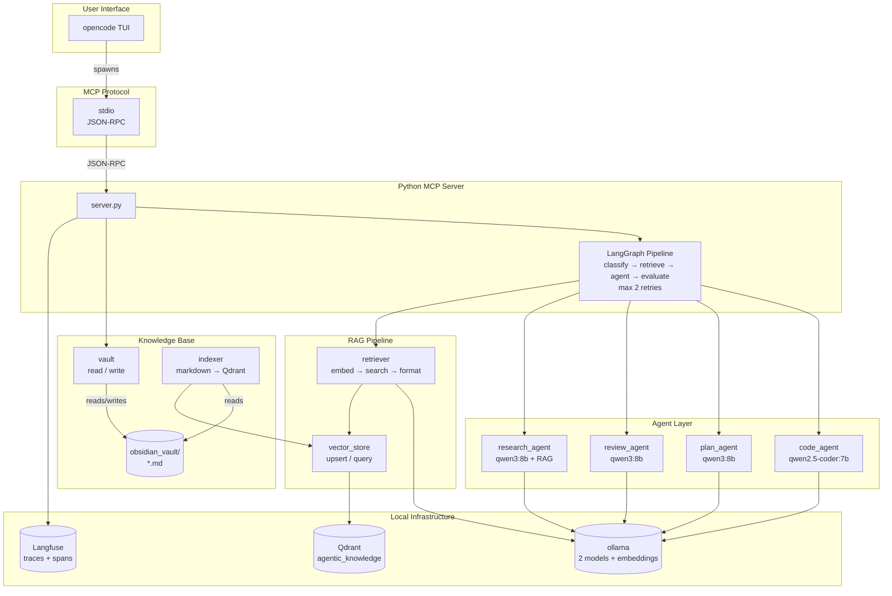
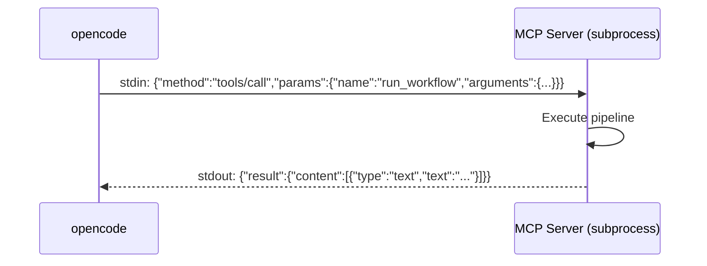
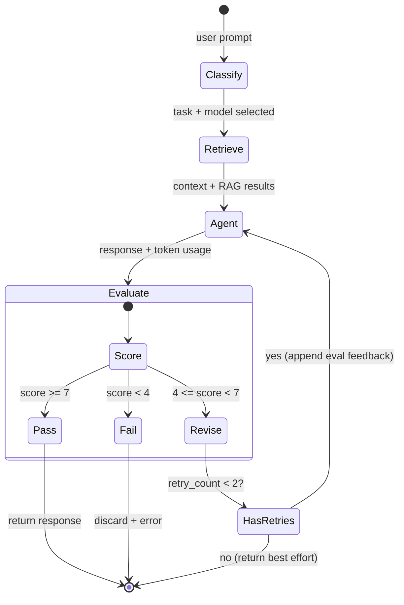
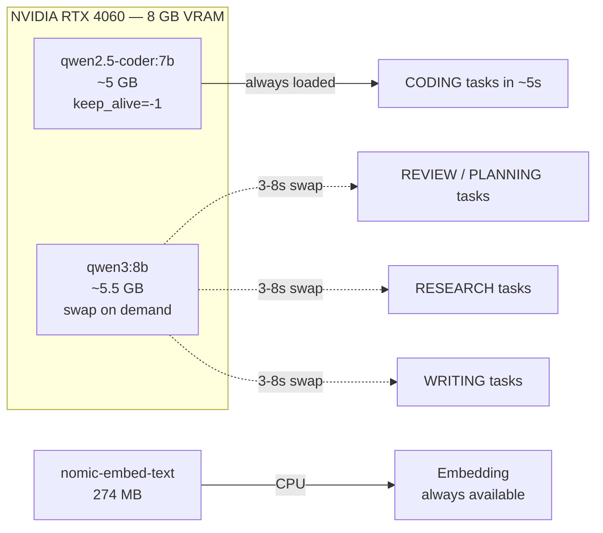

> *How I built an end-to-end AI coding pipeline that runs entirely on a laptop — with LangGraph, RAG, local LLMs, and deterministic skills — and why you might want to do the same.*

---

## The Problem

Every week there's a new AI coding tool. GitHub Copilot, Cursor, Windsurf, Claude Code, Codeium — the list grows faster than any team can evaluate them. They're fantastic products, but they share a common constraint: they ship you a **black box**.

You can't change the model. You can't see how the context is built. You can't add your own knowledge base, your own evaluation gates, your own infrastructure hooks. You're a passenger, not a driver.

I wanted something different. I wanted a **software factory** — a pipeline I can see end-to-end, modify at any stage, and run completely offline on my own hardware.

> [!NOTE]
> This isn't a critique of commercial tools. They solve real problems for millions of developers. This is about what happens when you need to go deeper — when you need to integrate AI into your own toolchain on your own terms.

---

## The Vision: What Is a "Software Factory"?

In manufacturing, a factory is a place where raw materials go through a series of defined processes and come out as finished goods. A **software factory** is the same idea: source code, requirements, and knowledge go in; tested, documented, reviewed code comes out.

The key insight is that each process in the factory should be:

- **Observable** — you can see what's happening at every step
- **Controllable** — you can tune, replace, or skip any step
- **Deterministic** — the same inputs should produce the same outputs (or at least predictable ones)
- **Offline-capable** — no data leaves your machine unless you choose to send it

Here's what I built:



---

## Architecture Overview

The system has four layers, each independently replaceable:

### 1. Interface Layer — opencode

[opencode](https://opencode.ai) is a terminal-based AI coding assistant. It provides the chat UI, manages agents, and communicates with the backend via the **Model Context Protocol** (MCP). I chose it because it's open source, extensible via agents and MCP tools, and runs entirely locally.

> [!IMPORTANT]
> The choice of interface matters less than the protocol. Any MCP-compatible client could replace opencode — the backend stays the same.

### 2. Transport Layer — MCP over stdio

The Model Context Protocol is an open standard for connecting AI agents to tools. Instead of HTTP (which introduces port conflicts, CORS, and network security concerns), I use **stdio transport**:



```python
# MCP server entry point — 13 tools registered
@server.tool()
async def run_workflow(prompt: str, thread_id: str = "") -> str:
    """Route a task through the LangGraph agent workflow."""
    state = await app.ainvoke({
        "prompt": prompt,
        "thread_id": thread_id,
        "task_type": "",
        "selected_model": "",
        "context_text": "",
        "agent_response": "",
        "usage": {},
        "error": None,
        "eval_score": None,
        "eval_verdict": None,
        "eval_feedback": None,
        "retry_count": 0,
    })
    return state["agent_response"]
```

### 3. Pipeline Layer — LangGraph State Machine

The heart of the system is a LangGraph state graph with four nodes:



**Node 1: Classify** — Keyword-based routing determines the task type:

```python
REVIEW_KEYWORDS = {"review", "audit", "quality", "bug", ...}
PLANNING_KEYWORDS = {"plan", "architecture", "design", ...}
CODING_KEYWORDS = {"write", "implement", "code", "function", ...}
RESEARCH_KEYWORDS = {"find", "search", "explain", "how", ...}
# Fallback: WRITING
```

Each task type maps to a different model and system prompt.

**Node 2: Retrieve** — RAG context is fetched from Qdrant:

```python
async def retrieve_context(query: str, top_k: int = 3) -> str:
    # 1. Embed the query
    vector = await generate_embedding(query)  # nomic-embed-text, 768-dim
    
    # 2. Search Qdrant
    results = vector_store.search_similar(vector, top_k=top_k)
    
    # 3. Format as context
    return "\n\n".join(
        f"## {r.payload['title']}\n{r.payload['content']}"
        for r in results
    )
```

**Node 3: Agent** — The selected model is called with system prompt + RAG context + user query.

**Node 4: Evaluate** — A separate evaluation call scores the response on four dimensions:

| Dimension | What it measures |
|-----------|-----------------|
| **Faithfulness** | Does the response stick to the provided context? |
| **Completeness** | Does it fully answer the user's question? |
| **Coherence** | Is it well-structured and logical? |
| **Actionability** | Can the user act on this response? |

If the score is below 7/10, the agent retries with evaluation feedback (up to 2 times):

```python
if state["eval_verdict"] == "revise" and state["retry_count"] < 2:
    state["context_text"] += (
        f"\n\nPrevious evaluation feedback (retry #{state['retry_count'] + 1}):\n"
        f"{state['eval_feedback']}"
    )
    # → loops back to agent_node
```

### 4. Infrastructure Layer — All Local

Everything runs on a single machine:

| Component | What | Why |
|-----------|------|-----|
| **ollama** | Model serving | Runs qwen2.5-coder:7b (coding) and qwen3:8b (writing/review) |
| **Qdrant** | Vector database | Stores embeddings from the Obsidian vault for RAG |
| **Langfuse** | Observability | Traces every LLM call with token counts and latency |
| **Postgres + ClickHouse + Redis + MinIO** | Langfuse backing | Required for Langfuse to work |

```bash
# Everything starts with one command
docker compose up -d

# ollama runs natively (for GPU access)
nohup ollama serve > /tmp/ollama.log 2>&1 &

# Verify
curl http://localhost:11434/api/tags
curl http://localhost:6333/healthz
curl http://localhost:3000/api/public/health
```

---

## The Two-Tier Model Strategy

This was the hardest constraint to design around: **8 GB of VRAM**.

A single 7B parameter model at Q4 quantization takes ~5 GB. An 8B model takes ~5.5 GB. They don't both fit. So I built a swap strategy:



**The code model** (`qwen2.5-coder:7b`) stays GPU-resident with `keep_alive=-1`. When you need coding, the response starts in ~5 seconds.

**The writer model** (`qwen3:8b`) is swapped in on demand. The swap takes 3-8 seconds — barely noticeable for review or planning tasks that run for 30-90 seconds anyway.

```python
# Pre-load the writer model into VRAM
def preload_model(model_name: str) -> str:
    response = httpx.post(
        f"{OLLAMA_HOST}/api/generate",
        json={"model": model_name, "prompt": "", "keep_alive": -1},
        timeout=120,
    )
    return f"Model loaded: {model_name}"

# Unload when done
def unload_model(model_name: str) -> str:
    response = httpx.post(
        f"{OLLAMA_HOST}/api/generate",
        json={"model": model_name, "prompt": "", "keep_alive": 0},
        timeout=30,
    )
    return f"Model unloaded: {model_name}"
```

> [!TIP]
> For a review session, pre-load the writer model *once*, run all your reviews, then unload. The code model stays hot the whole time.

---

## The RAG Pipeline: Obsidian + Qdrant

Knowledge is everything in AI-assisted development. Without good context, LLMs hallucinate. So I built a knowledge base pipeline:

```
Write a note → embed via nomic-embed-text → store in Qdrant → retrieve on query
```

### How notes are indexed

```python
import uuid

async def index_note(note_path: str, content: str) -> None:
    """Embed a note and upsert it to Qdrant."""
    vector = await generate_embedding(content)
    point_id = uuid.uuid5(uuid.NAMESPACE_DNS, f"obsidian_{note_path}").hex
    
    payload = {
        "path": note_path,
        "title": extract_title(content),
        "content": content[:8000],  # max context for embedding
    }
    
    vector_store.upsert(points=[PointStruct(id=point_id, vector=vector, payload=payload)])
```

The point ID is a **deterministic UUID** derived from the file path. This means re-indexing the same note overwrites the existing vector — no duplicates, no wasted storage.

### How context is retrieved

```
User query → embed (768-dim) → Qdrant cosine search (top_k=3) → format → prepend to LLM prompt
```

```python
async def retrieve_context(query: str, top_k: int = 3) -> str:
    query_vector = await generate_embedding(query)
    results = vector_store.search_similar(query_vector, top_k=top_k)
    
    if not results:
        return ""
    
    sections = []
    for r in results:
        sections.append(
            f"## From: {r.payload['title']}\n{r.payload['content'][:2000]}"
        )
    return "\n\n---\n\n".join(sections)
```

> [!WARNING]
> The embedding model (`nomic-embed-text`) has a 2048-token context window. Notes longer than that get truncated. Keep individual notes focused on one concept.

### Writing good notes

The quality of RAG search depends on how notes are written:

```markdown
# Title (be specific — "ClickHouse Migration Fix" not "Notes")

## Summary
One paragraph covering the core concept. This anchors the embedding.

## Details
Full explanation with code examples and edge cases.

## Related
- [[Related Note]] — wiki-style cross-references
```

Bad notes are too short, have vague titles, or bundle multiple concepts. Good notes have clear structure and use consistent terminology.

---

## The Deterministic Skills System

LLMs are great for creative tasks but terrible for operations. You don't want a model deciding how to check GPU memory or query a vector database. For those tasks, you want **deterministic scripts** with clear inputs and outputs.

I built five "skills" — collections of Python scripts, reference docs, and examples:

```bash
.opencode/skills/
├── INDEX.md
├── vector-store/              # Qdrant: search, stats, manage points
│   ├── SKILL.md
│   ├── scripts/               # 4 Python scripts
│   ├── references/            # API schemas, config, troubleshooting
│   └── examples/              # Common workflows
├── vault-knowledge/           # Obsidian: read, write, search, reindex
│   ├── SKILL.md + scripts/ + references/ + examples/
├── model-inference/           # Ollama: completion, embed, VRAM, preload
│   ├── SKILL.md + scripts/ + references/ + examples/
├── tracing-observability/     # Langfuse: traces, ingestion, datasets
│   ├── SKILL.md + scripts/ + references/ + examples/
└── pipeline-docs/             # Self-documentation: validate, generate, index
    ├── SKILL.md + scripts/ + references/ + examples/
```

Each skill has:
- **`SKILL.md`** — YAML metadata + usage instructions
- **`scripts/`** — Python scripts with argparse, error handling, clear output
- **`references/`** — API schemas, configuration guides, troubleshooting
- **`examples/`** — Real-world workflow examples

```bash
# Example: Check vector store health
uv run python .opencode/skills/vector-store/scripts/collection_stats.py

# Example: Search the knowledge base
uv run python .opencode/skills/vault-knowledge/scripts/search_vault.py \
  --query "How does LangGraph classify tasks?"

# Example: Pre-load a model for review
uv run python .opencode/skills/model-inference/scripts/preload_model.py \
  --model "qwen3:8b-q4_K_M"

# Example: Debug Langfuse ingestion
uv run python .opencode/skills/tracing-observability/scripts/check_ingestion.py
```

> [!NOTE]
> Every script handles connection failures gracefully. If ollama is down, they print the fix command and exit. If Qdrant is unreachable, they show the docker compose command. No crashes, no stack traces.

---

## Observability with Langfuse

Every pipeline execution is traced:

```
Trace (run_workflow)
├── Span: classify_node
│   ├── Input: "Review mcp_server/server.py for bugs"
│   └── Output: task_type=REVIEW, model=qwen3:8b
├── Span: retrieve_node
│   ├── Input: same query
│   └── Output: 3 RAG results from Qdrant
├── Span: agent_node (attempt 1)
│   ├── Generation: LLM call → 45 in / 320 out tokens
│   └── Output: review response
└── Span: evaluate_node
    ├── Generation: LLM eval call → 520 in / 80 out tokens
    └── Output: score=8/10, verdict=pass
```

```bash
# Debug traces from the command line
uv run python .opencode/skills/tracing-observability/scripts/list_traces.py --limit 5
uv run python .opencode/skills/tracing-observability/scripts/get_trace.py --trace-id "0195..."
```

> [!IMPORTANT]
> Langfuse's ingestion API accepts events (HTTP 201) but the background worker may not flush them to ClickHouse in the combined Docker image. If traces are missing, check with `check_ingestion.py` and consider splitting into `langfuse-web` + `langfuse-worker` containers.

---

## Key Design Decisions

### Why LangGraph instead of a simple script loop?

```python
# Instead of:
while retry_count < max_retries:
    response = llm_call(prompt)
    score = evaluate(response)
    if score >= 7: break

# Use a state graph:
class AgentState(TypedDict):
    prompt: str
    task_type: str
    selected_model: str
    context_text: str
    agent_response: str
    usage: dict
    error: str | None
    eval_score: int | None
    eval_verdict: str | None
    eval_feedback: str | None
    retry_count: int
```

A state graph makes every variable explicit and inspectable. Each node is independently testable. Adding a new node (validation, post-processing, code execution) is trivial.

### Why MCP over HTTP?

- No port conflicts or firewall issues
- Process lifecycle managed by the client
- Simpler security model (no network exposure)
- Built-in backpressure via the pipe buffer

### Why Obsidian vault for knowledge?

Markdown is universal. You can edit it with any text editor, version it with git, and display it in any tool. The Obsidian vault structure maps directly to the file system — there's no proprietary format or lock-in.

### Why deterministic skills alongside agents?

LLMs are unreliable for operations. A model might hallucinate the nvidia-smi command or guess a wrong Qdrant API endpoint. Skills provide a **guaranteed correct path** — the same inputs always produce the same outputs. Use agents for creative work, skills for deterministic operations.

---

## Infrastructure: The Complete Stack

```yaml
services:
  postgres:      # image: postgres:17-alpine     — Langfuse primary DB
  clickhouse:    # image: clickhouse/clickhouse-server — Langfuse analytics
  redis:         # image: redis:7-alpine          — Job queue
  minio:         # image: minio/minio:latest      — S3 object storage
  langfuse:      # image: ghcr.io/langfuse/langfuse — Web UI + API
  qdrant:        # image: qdrant/qdrant:latest    — Vector database
```

```bash
# Daily health check (one-liner)
echo "GPU: $(nvidia-smi --query-gpu=memory.used,memory.total --format=csv,noheader)"
echo "Ollama: $(curl -s http://localhost:11434/api/tags | python3 -c 'import sys,json;print(len(json.load(sys.stdin).get(\"models\",[])))') models"
echo "Qdrant: $(curl -s http://localhost:6333/collections | python3 -c 'import sys,json;print(list(json.load(sys.stdin)[\"result\"].keys()))')"
echo "Langfuse: $(curl -s -o /dev/null -w '%{http_code}' http://localhost:3000/api/public/health)"
```

### Known Infrastructure Issue

Langfuse's combined Docker image (`ghcr.io/langfuse/langfuse:latest`) runs both the web server and the background worker in one container. In practice, the worker often doesn't process the ingestion queue, so traces are accepted (HTTP 201) but never persist to ClickHouse.

**Fix:** Use split images:
- `langfuse-web` — serves the API and UI
- `langfuse-worker` — processes ingestion → ClickHouse

---

## Workflow Examples

### Example 1: Code Review with RAG Context

```bash
# In opencode:
@reviewer review mcp_server/graph.py for state management issues

# What happens:
# 1. Classify → REVIEW → qwen3:8b (swapped in, ~5s)
# 2. Retrieve → search Qdrant for "state management" → 3 relevant notes
# 3. Agent → LLM reviews the code with RAG context (~30-60s)
# 4. Evaluate → score 8/10 → pass → return
# Total: ~45-75s
```

### Example 2: Knowledge Base Research

```bash
# In opencode:
@researcher how does the DAG engine handle dependencies?

# 1. Classify → RESEARCH → qwen3:8b
# 2. Retrieve → Qdrant finds "dependencies" notes
# 3. Agent → explains with context, references source files
# 4. Evaluate → checks factual accuracy against context
```

### Example 3: Architecture Decision

```bash
# In opencode:
@planner design a plugin system for the MCP server. save to vault.

# 1. Classify → PLANNING → qwen3:8b
# 2. Retrieve → finds existing architecture patterns
# 3. Agent → produces design document
# 4. Evaluate → checks coherence and completeness
# 5. Automatically saved to obsidian_vault/ for future RAG
```

### Example 4: Debugging a Failed Pipeline

```bash
# Step 1: Check Langfuse
uv run python .opencode/skills/tracing-observability/scripts/ping_langfuse.py

# Step 2: Test each pipeline stage individually
uv run python -c "from mcp_server.model_router import classify_task; print(classify_task('test'))"
uv run python -c "import asyncio; from mcp_server.rag.retriever import retrieve_context; print(asyncio.run(retrieve_context('test', top_k=2)))"
uv run python -c "import asyncio; from mcp_server.agents.research_agent import run_research_agent; print(asyncio.run(research_agent('test', '')))"

# Step 3: Check VRAM
uv run python .opencode/skills/model-inference/scripts/vram_check.py
```

---

## Lessons Learned

### What worked well

1. **LangGraph state machine** — The explicit state and node-by-node execution makes debugging trivial. Each node is a pure function with typed inputs and outputs.

2. **MCP protocol** — stdio transport is elegant. No ports, no auth, no network config. The server is a subprocess that communicates over pipes.

3. **Deterministic skill scripts** — Before skills, every operation required an LLM call. Now infrastructure checks, vector queries, and vault operations are instant and reliable.

4. **Two-tier model strategy** — The 7B coding model handles 90% of tasks. The 8B model is only needed for review and planning. Swapping takes seconds and saves 5 GB of VRAM.

### What I'd do differently

1. **Langfuse ingestion** — The combined Docker image doesn't run the background worker properly. Split the images from day one.

2. **ClickHouse migration** — The migration URL must use query-parameter auth, not connection string auth. Lost hours to this.

3. **Smaller embedding model** — nomic-embed-text at 274 MB works well but a smaller model would run faster on CPU. Consider `all-MiniLM-L6-v2` at 80 MB.

4. **Note quality** — The first batch of vault notes was too short and vague. RAG quality improved dramatically when I started writing detailed notes with clear summaries.

---

## What's Next

The factory is built, but it's far from complete:

1. **Fix Langfuse ingestion** — Switch to split Docker images so traces persist properly
2. **Code execution tool** — Add a tool that runs tested code in a sandbox
3. **Automated test generation** — Pipeline that analyzes code, generates tests, runs them, and iterates
4. **Multi-repo support** — Index multiple repositories into Qdrant for cross-project RAG
5. **Web search tool** — Add web search capability for current documentation
6. **Fine-tuned models** — Fine-tune the 7B model on the project's codebase for better code generation

---

## The Code

Everything is open source:

```
├── opencode.json              # opencode configuration
├── docker-compose.yml         # Infrastructure: Langfuse, Qdrant, Postgres, ClickHouse
├── mcp_server/                # Python MCP server with LangGraph pipeline
│   ├── server.py              # 13 MCP tools
│   ├── graph.py               # LangGraph state graph
│   ├── model_router.py        # Task classification + ollama API
│   ├── evaluation.py          # Response quality scoring
│   ├── agents/                # Code, plan, review, research agents
│   ├── rag/                   # Qdrant vector store + retriever
│   └── obsidian/              # Vault read/write/index
├── .opencode/skills/          # 5 deterministic skills, 59 files
│   ├── vector-store/          # Qdrant scripts + references
│   ├── vault-knowledge/       # Obsidian scripts + references
│   ├── model-inference/       # Ollama scripts + references
│   ├── tracing-observability/ # Langfuse scripts + references
│   └── pipeline-docs/         # Self-documentation tools
└── obsidian_vault/            # Markdown knowledge base
    ├── long-term/             # Reference docs
    ├── short-term/            # Plans and proposals
    └── changelogs/            # Development history
```

---

## Why Build This?

Because control matters.

Commercial AI coding tools are incredible, but they're **platforms** — you use them on their terms. When your team needs custom evaluation gates, specific RAG sources, offline operation, or integration with existing tooling, platforms become walls.

A software factory is the opposite. It's a set of interoperable components you can see, modify, and replace. The LangGraph pipeline can be extended with new nodes. The RAG system can point at any vector store. The skills are just Python scripts. The agents are just prompts with tool access.

You're not a passenger. You're the factory engineer.

---

*Built with opencode, LangGraph, ollama, Qdrant, Langfuse, and 8 GB of laptop VRAM.*
