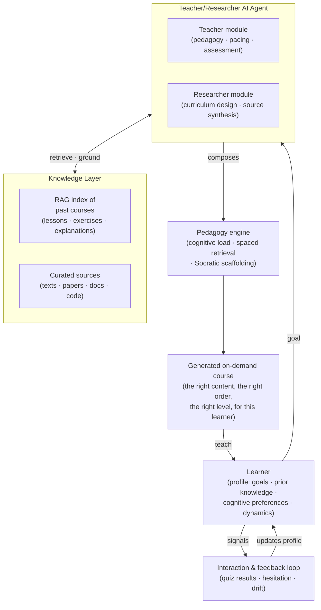

> *Nuniversity is a non-profit building a universal learning platform for sciences, engineering, coding and technology. Today: an MVP with a growing course library. Target vision: a teacher/researcher AI agent over a RAG index of past courses, composing an on-demand course for every learner, matched to that person's cognitive preferences and learning dynamics.*

## The Mission

Nuniversity is a non-profit education company built on one conviction: transformational education should be free, and good, for everyone. We focus on the disciplines that most reliably change a person's trajectory: sciences, engineering, coding and technology. What runs today is an MVP learning platform with a growing course library. What we are engineering toward, our target version, is a platform where a teacher/researcher AI agent composes a new course for each learner on demand, grounded in everything the platform has ever taught.

Explore the current platform at [nuniversity.github.io/en](https://nuniversity.github.io/en/).

## The Problem

Good education is still one of the most gate-kept resources on the planet. The best explanation of Maxwell's equations, the clearest introduction to distributed systems, the most patient calculus teacher in the world: all of it exists, somewhere. Access doesn't.

The gates are the usual ones:

- **Cost**: quality instruction is priced for those who already have opportunity.
- **Geography**: talent is uniformly distributed; teachers and infrastructure are not.
- **Format**: even free content is one-size-fits-all. A course built for a full-time student ignores the dock worker studying at midnight, the career changer in a rural town, the neurodivergent learner whose attention works differently.

Here is the uncomfortable part: the technologies that could dissolve these gates, AI agents and retrieval-augmented generation, obey the economics of software. Serving one more learner costs almost nothing. Yet most of that capability is being wrapped into subscription products instead.

We decided to flip that.

## What Is Real Today

To be honest about where we are on the journey. Today, Nuniversity is:

- A live platform at [nuniversity.github.io/en](https://nuniversity.github.io/en/), led by a small founding team based in Brazil and working worldwide.
- An initial course library focused on foundational sciences, engineering and technology topics.
- An MVP in active development: forming the team, fundraising, talking to educators and learners, and running the processes that let the library grow.

The personalized, AI assisted course system described in the next section is our target architecture, not a shipped feature. That distinction matters to us: this is a pitch about a future version, built step by step from a real platform.

## The Target Vision: On-Demand Courses for Every Learner

The core insight behind our roadmap: courses are static, learners are dynamic. A course is a frozen artifact; its sequence, depth, examples and pace were optimised for the median of an imagined audience. You are not the median.

Every learner brings a different profile:

- **Prior knowledge**: you may know half the material, but which half?
- **Cognitive preferences**: first principles or worked examples, visuals or text, bottom up or top down.
- **Dynamics**: your pace, your session length, what you retain after a week, where you get stuck.

So the target version of Nuniversity looks like this:

In words, four components make the leap from static courses to on-demand ones:

### 1. A RAG index over past courses

Everything the platform produces (lessons, exercises, explanations, worked answers) becomes retrievable knowledge. RAG matters here because education punishes hallucination: the proven pattern in tutoring research is to ground every AI response in curated, authoritative sources, which is also what measurably builds learner trust.

### 2. A teacher/researcher agent

Not a chatbot with a textbook. Two cooperating roles:

- The **researcher** decides what belongs in the course. It surveys the RAG index and curated sources, maps concept dependencies and designs the curriculum skeleton.
- The **teacher** decides how to deliver it. Sequencing, examples drawn from the learner's own world, when to explain, when to ask, when to quiz.

### 3. A pedagogy engine in the loop

The composition step applies what cognitive science already knows: adaptive difficulty that keeps the learner near the edge of their ability, spaced retrieval for retention, Socratic questioning for durable understanding. These are parameters of the system, not afterthoughts.

### 4. The feedback loop that makes it personal

Every interaction (a correct answer, a wrong one, a skip, a session gap) updates the learner model. The course is not generated once. It continuously regenerates around the learner as they move. Static courses serve their median student. This loop serves exactly one student: yours.

The vision in one sentence: extract the best teacher for you from the collective knowledge of every course ever taught, and make it free.

## Why Free Is the Design Choice, Not a Bug

There is a fair objection: "AI tutoring is getting cheaper. Won't the market solve this?"

Partially. But the market optimises for those who can pay, and the educational gap is largest exactly where paying is not possible. The distance between "AI tutor for the wealthy" and "AI tutor for everyone" is the gap a non-profit exists to close. When the marginal cost of serving one more learner approaches zero, the gating resource becomes access and trust, not cost.

## Why Us

I have spent 9+ years building data platforms: lakehouses, pipelines, ML systems, AI agents. The same engineering discipline applies: ground the models, instrument the loops, measure learning the way we measure forecast accuracy. What changes is the objective function. At Nuniversity, success is not revenue per user. It is opportunity created, measured by how many people who were previously locked out are now inside the room.

## Status and the Ask

We are at the beginning, and the mission compounds: every course added, every learner model refined, makes the next learner's experience better.

If this resonates, as a **learner**, a **volunteer educator**, a **researcher in AI and education**, or a **supporter**, I would love to hear from you.

Visit the platform at **[nuniversity.github.io/en](https://nuniversity.github.io/en/)**, connect on [LinkedIn](https://www.linkedin.com/in/leandroalveso), or [email me](mailto:engleandroalveso@gmail.com).

*Education is upstream of everything. Let's build it for everyone.*
